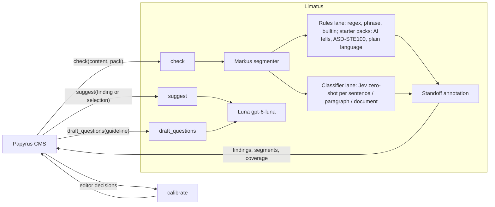

# Editorial compliance engine (vision)

Kanbus initiative: `LIM-a5828a`. First integration: Papyrus initiative `PPY-ed678d`.

This page is the durable record of where Limatus is going. If a session loses
context, start here.

## The product

Limatus is a **configurable editorial compliance tool** that can implement any
publication's editorial guidelines and policies. A CMS sends its policies and
options with every request; Limatus finds where a draft breaks them and, only
when an editor asks, suggests rewrites. Editors stay in control of every change.

What an editor experiences in Papyrus:

1. Write in the article editor (CodeMirror 6). Problems are underlined in place,
   coloured by severity, with a findings panel grouped by policy.
2. Click a finding to see the policy, why it fired, and (for classifier findings)
   how sure the model is. "Review" findings mean the model is unsure.
3. Ask for rewrite options on a finding — **or select any sentence or paragraph
   and ask for rewrites of it**, with an optional note ("shorter", "less formal").
   Accept one option, or dismiss the finding with a reason.
4. Publishing is never blocked; open findings show as a warning.
5. Admins manage policies in Papyrus: write guidance in prose, let Luna draft
   classifier questions from it, tune them in a "try it" box, set severity and scope.

## Architecture

- **Policy pack** (`policy-pack-v1`): versioned policies supplied per request.
  Each policy has prose guidance, severity `info|warn|error`, detectors, examples
  and rewrite guidance. Limatus is stateless.
- **Rules lane**: deterministic and NLP checks. Includes a built-in "AI-writing
  tells" pack ported from avoid-ai-writing (MIT).
- **Classifier lane**: TypeSafe Jev, zero-shot. One request per segment carrying
  every applicable question; cached by question fingerprint + segment hash so
  rescans only re-query changed text; `reviewAt` band until calibrated.
- **Suggestions**: Luna (`gpt-6-luna`) only. Never used to find problems.
  Works on a finding or on an arbitrary editor selection.
- **Output** (`check-result-v1`): segments, protected regions, findings and
  coverage, offsets in UTF-16 code units, finding ids stable across rescans.
- **Feedback**: editor accept/dismiss become labels → per-policy calibration
  (isotonic), few-shot example retrieval.

## Decisions (2026-10-19)

1. Luna may draft Jev questions at policy-authoring time; the editor approves.
2. No publish gate; findings are advisory warnings.
3. CodeMirror 6 replaces the Papyrus body `<Textarea>`.
4. No backward compatibility: the judge lane and the old
   scan → decide → options → apply loop may be replaced.
5. Editors can request rewrites for any selected span, not only for findings.

## Roadmap

| Order | Epic | Repo |
| --- | --- | --- |
| 1 | `LIM-6a84be` Policy-pack contracts and Markus-aware segmenter | Limatus |
| 2 | `LIM-dc05d2` Rules lane on policies + AI-writing tells pack | Limatus |
| 3 | `LIM-3f3065` Jev zero-shot classifier lane | Limatus |
| 4 | `LIM-7906a5` Luna suggestions (findings and selections) and authoring assist; remove judge | Limatus |
| 5 | `LIM-9ba0bf` Editor feedback labels and calibration | Limatus |
| 6 | `PPY-4f539b` Storage, plugin and Lambda | Papyrus |
| 7 | `PPY-8473b0` Editorial checks admin panel | Papyrus |
| 8 | `PPY-95f751` Copy-editing component (CodeMirror 6) | Papyrus |
| 9 | `PPY-0233f1` Editor feedback capture | Papyrus |

## References

- avoid-ai-writing: https://github.com/conorbronsdon/avoid-ai-writing
- Jev client template: `~/Projects/Jev-Flywheel/jev_flywheel/jev.py`
- Jev calibration: `~/Projects/Jev-Calibration/README.md`
- Luna client quirks (send `max_completion_tokens`, omit `temperature`):
  `~/Projects/Decision-Flywheel-Evaluations/src/decision_flywheel_evaluations/unified_openai.py`
